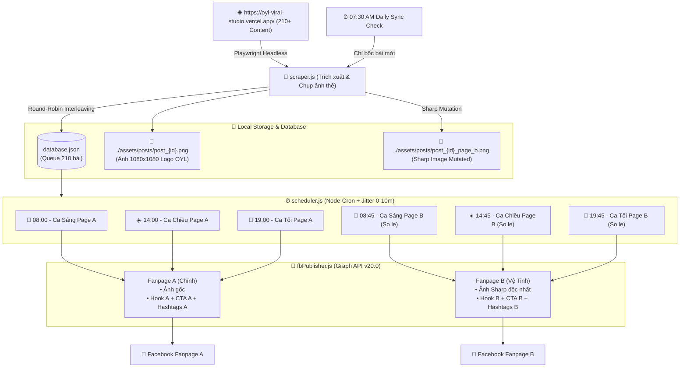

# 🚀 HỆ THỐNG MARKETING AUTOMATION TỰ ĐỘNG HÓA FANPAGE OYL GLOBAL
> **Antigravity Marketing Automation Engine** — Tự động bốc tách 210+ bài viết từ [OYL Viral Studio](https://oyl-viral-studio.vercel.app/), phân loại chủ đề, xếp lịch xoay vòng Round-Robin, đồng bộ gia tăng hàng ngày (07:30 AM) và tự động xuất bản 3 bài/ngày lên **2 Fanpage song song** (Page A & Page B) với công nghệ biến tấu ảnh (Sharp Image Mutation) & biến tấu caption chống phạt trùng lặp Meta.

---

## 📑 MỤC LỤC
1. [Kiến Trúc Tổng Thể & Luồng Hoạt Động](#1-kiến-trúc-tổng-thể--luồng-hoạt-động)
2. [Đặc Thù Nguồn Dữ Liệu & Playwright Scraper](#2-đặc-thù-nguồn-dữ-liệu--playwright-scraper)
3. [Thuật Toán Xếp Lịch Xoay Vòng (Round-Robin Interleaving)](#3-thuật-toán-xếp-lịch-xoay-vòng-round-robin-interleaving)
4. [Quy Trình Phân Phối 2 Fanpage Song Song (Dual-Channel Distribution)](#4-quy-trình-phân-phối-2-fanpage-song-song-dual-channel-distribution)
5. [Cơ Chế Biến Tấu Ảnh & Caption Chống Meta Duplicate](#5-cơ-chế-biến-tấu-ảnh--caption-chống-meta-duplicate)
6. [Lịch Trình 3 Ca Đăng & Tác Vụ Đồng Bộ Gia Tăng 07:30](#6-lịch-trình-3-ca-đăng--tác-vụ-đồng-bộ-gia-tăng-0730)
7. [Hướng Dẫn Cài Đặt & Cấu Hình .env](#7-hướng-dẫn-cài-đặt--cấu-hình-env)
8. [Tập Lệnh CLI & Chế Độ Dry-Run Kiểm Thử](#8-tập-lệnh-cli--chế-độ-dry-run-kiểm-thử)

---

## 1. KIẾN TRÚC TỔNG THỂ & LUỒNG HOẠT ĐỘNG



---

## 2. ĐẶC THÙ NGUỒN DỮ LIỆU & PLAYWRIGHT SCRAPER

Hệ thống trích xuất tự động từ web app **OYL Viral Studio**:
- **Trích xuất thẻ ảnh Quote Card**:
  - Mỗi bài viết được render động trên một thẻ `<canvas id="canvas_{id}">` với độ phân giải chuẩn mạng xã hội **1080 × 1080 px**.
  - Bức ảnh chứa nền nhiếp ảnh (sách mở, rừng cây, sông núi), lớp phủ Cinematic Vignette, viền bo góc hiện đại, câu quote định dạng font *Playfair Display* và **Logo OYL Global đã xóa nền 100% in ở góc phải**.
  - Playwright chụp và kết xuất trực tiếp ra tệp ảnh chất lượng nguyên bản: `./assets/posts/post_{id}.png`.
- **Trích xuất Caption & Topic**:
  - Gồm Tiêu đề/Quote, Thân bài phân tích chi tiết, Emoji trực quan, Lời kêu gọi hành động (CTA) và Bộ Hashtags lan tỏa.
  - Nhận diện 7 nhóm chủ đề chính:
    1. `KỲ THI RIÊNG (HSA · TSA · V-ACT)` (30 bài)
    2. `HỌC BỔNG VỪA HỌC VỪA LÀM 70/30` (50 bài)
    3. `TUYỂN SINH & CHỌN NGÀNH` (80 bài)
    4. `LẬP TRÍ` (20 bài)
    5. `LẬP ĐẠO` (10 bài)
    6. `LẬP THÂN` (10 bài)
    7. `LẬP NGHIỆP` (10 bài)

---

## 3. THUẬT TOÁN XẾP LỊCH XOAY VÒNG (ROUND-ROBIN INTERLEAVING)

Để giữ cho fanpage luôn tươi mới, kích thích thuật toán Facebook phân phối tiếp cận:
1. **Phân rã theo nhóm chủ đề**: Gom toàn bộ bài viết vào 7 hàng đợi riêng biệt.
2. **Xen kẽ xoay vòng (Round-Robin)**: Bốc lần lượt mỗi chủ đề 1 bài (Chủ đề 1 ➔ 2 ➔ 3 ➔ 4 ➔ 5 ➔ 6 ➔ 7 ➔ Lặp lại).
3. **Quy tắc chống trùng trong ngày (Zero-Collision Guarantee)**:
   - Trong cùng 1 ngày (3 ca: Sáng - Chiều - Tối), tuyệt đối **3 bài thuộc 3 nhóm chủ đề khác nhau**.
   - Chủ đề có số lượng lớn (ví dụ: *Tuyển sinh & Chọn ngành*) được phân bổ đều đặn xuyên suốt 70 ngày, không bao giờ xuất hiện 2 lần liên tiếp.

---

## 4. QUY TRÌNH PHÂN PHỐI 2 FANPAGE SONG SONG (DUAL-CHANNEL DISTRIBUTION)

Hệ thống đóng vai trò như một **Tổng biên tập tự động** quản lý 2 kênh Fanpage:

| Tiêu Chí | Fanpage A (Kênh Chính) | Fanpage B (Kênh Vệ Tinh) |
|---|---|---|
| **Mục tiêu kênh** | Định vị thương hiệu OYL Global uy tín, chuẩn mực | Lan tỏa thực chiến, kích thích tò mò, tiếp cận tệp mới |
| **Lịch đăng trong ngày** | **08:00** — **14:00** — **19:00** | **08:45** — **14:45** — **19:45** (Lệch 45 phút) |
| **Nội dung bài đăng** | Bài $N$ trong hàng đợi | Bài so le $N+1$ (hoặc độ trễ ngày) |
| **Hình ảnh sử dụng** | Ảnh Quote Card chuẩn gốc | Ảnh Sharp xử lý viền, độ sáng & Metadata độc nhất |
| **Hook mở đầu** | Chuẩn xác, học thuật, uy tín | Câu hỏi gợi mở, góc nhìn phản biện, kích thích click |
| **Call-To-Action** | Nhận lộ trình tư vấn 1:1 từ chuyên gia | Nhận cẩm nang tài liệu, inbox hỗ trợ nhanh |

---

## 5. CƠ CHẾ BIẾN TẤU ẢNH & CAPTION CHỐNG META DUPLICATE

### 🖼️ Biến tấu hình ảnh (Image Mutation qua Sharp):
Khi đăng lên Page B, module `src/imageMutator.js` tự động:
1. **Micro-Crop**: Cắt ngẫu nhiên 2 - 3 pixel mỗi cạnh viền ảnh.
2. **Micro-Grade**: Điều chỉnh nhẹ 1% độ sáng (brightness) và độ tương phản (contrast).
3. **Metadata Injection**: Xóa sạch metadata cũ, chèn chuỗi ký danh số (Unique GUID + Timestamp).
4. **Kết quả**: Mã Hash SHA-256 và pHash (Perceptual Hash) của ảnh Page B **khác biệt 100%** so với Page A, loại bỏ hoàn toàn nguy cơ bị Meta quét nhận diện ảnh trùng lặp.

### 📝 Biến tấu Caption (Caption Variator):
- **Hook Page B**: Sử dụng bộ quy tắc xoay vòng công thức Hook thực chiến (Ví dụ: `✨ [BỐ MẸ VÀ CÁC CON ĐÃ BIẾT CHƯA?]`, `⚡ CHIẾN LƯỢC QUAN TRỌNG ĐỂ KHÔNG BỎ LỠ CƠ HỘI...`).
- **Core Message**: Giữ nguyên vẹn 100% tri thức và thông điệp giá trị.
- **CTA & Hashtags**: Tách bạch bộ nhận diện riêng giữa 2 kênh.

---

## 6. LỊCH TRÌNH 3 CA ĐĂNG & TÁC VỤ ĐỒNG BỘ GIA TĂNG 07:30

Mỗi ngày, daemon scheduler tự động kích hoạt:
- **07:30 AM — Tác vụ Incremental Sync**:
  - Quét trang `https://oyl-viral-studio.vercel.app/`.
  - So sánh với `database.json`: Nếu có bài mới (ví dụ: tác giả thêm 5 bài mới), hệ thống tự động tải ảnh, biến tấu ảnh, gán chủ đề và bổ sung vào hàng đợi.
  - Bỏ qua toàn bộ bài cũ để tối ưu tốc độ và không làm lệch lịch trình đã xếp.
- **08:00 AM & 08:45 AM — Ca Sáng** (Độ trễ ngẫu nhiên 0 - 10 phút chống quét spam).
- **14:00 PM & 14:45 PM — Ca Chiều** (Độ trễ ngẫu nhiên 0 - 10 phút).
- **19:00 PM & 19:45 PM — Ca Tối** (Độ trễ ngẫu nhiên 0 - 10 phút).

---

## 7. HƯỚNG DẪN CÀI ĐẶT & CẤU HÌNH .ENV

### Bước 1: Sao chép tệp cấu hình
```bash
cp .env.example .env
```

### Bước 2: Điền thông tin Facebook Fanpage vào `.env`
```env
# Page A (Fanpage Chính)
PAGE_A_ID=100089xxxxxxxxx
PAGE_A_TOKEN=EAAxxxxxxxxx... (Page Access Token dài hạn)
PAGE_A_NAME=Own Your Life Global

# Page B (Fanpage Vệ Tinh)
PAGE_B_ID=100092xxxxxxxxx
PAGE_B_TOKEN=EAAxxxxxxxxx...
PAGE_B_NAME=Tự Chủ Cuộc Đời

# Chế độ chạy: true = Kiểm tra thử không đăng thật, false = Đăng thật lên Facebook
DRY_RUN=false

# Độ trễ ngẫu nhiên tối đa (phút)
RANDOM_JITTER_MAX_MINUTES=10
```

> **Cách lấy Long-Lived Page Access Token**:
> 1. Truy cập [Facebook Graph API Explorer](https://developers.facebook.com/tools/explorer/).
> 2. Chọn App của bạn, cấp quyền: `pages_manage_posts`, `pages_read_engagement`.
> 3. Chọn Page A / Page B và sao chép User Token -> Tạo Page Access Token dài hạn.

---

## 8. TẬP LỆNH CLI & CHẾ ĐỘ DRY-RUN KIỂM THỬ

```bash
# 1. Chạy chế độ xem trước ngày đầu tiên (Dry-Run: kiểm tra ảnh, caption 2 page, lịch trình 3 khung giờ)
npm run dry-run

# 2. Bốc toàn bộ 210 bài viết và render thẻ ảnh về máy cục bộ
npm run scrape

# 3. Chạy thủ công tác vụ đồng bộ gia tăng (chỉ lấy bài mới)
npm run sync

# 4. Kích hoạt Daemon chạy ngầm 24/7 theo lịch 07:30 + 3 ca/ngày
npm run schedule

# 5. Đăng thử ngay 1 bài tiếp theo lên Fanpage A (hoặc Page B)
npm run publish-now -- --page=A
npm run publish-now -- --page=B

# 6. Xem tiến độ hàng đợi và số lượng bài đã xuất bản
npm run status
```
